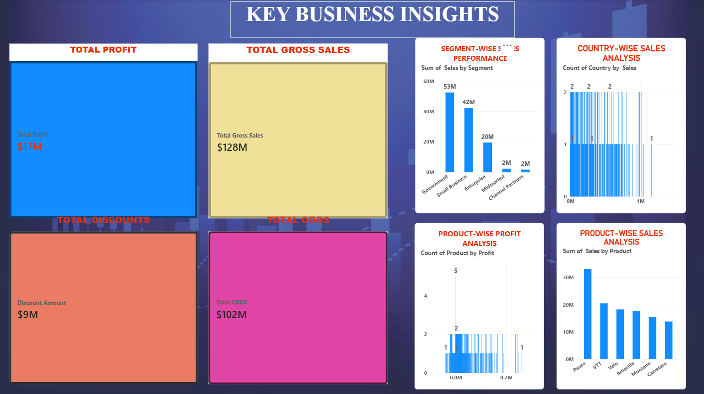
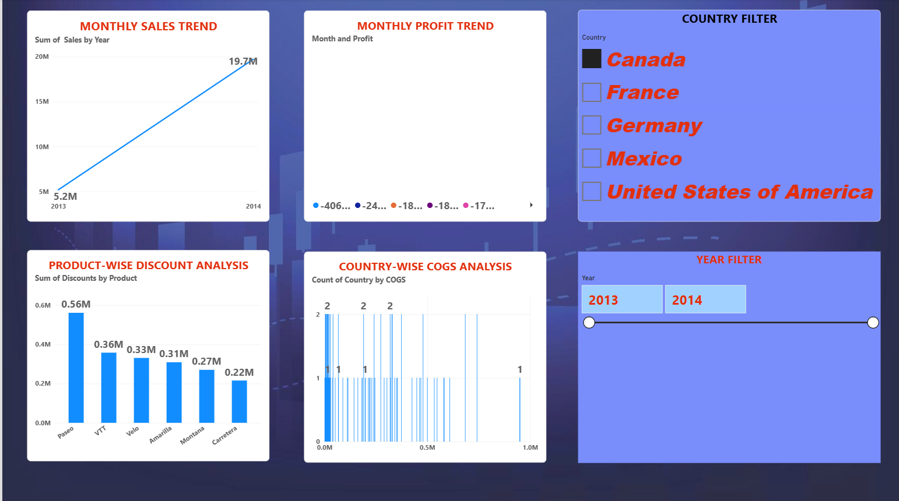
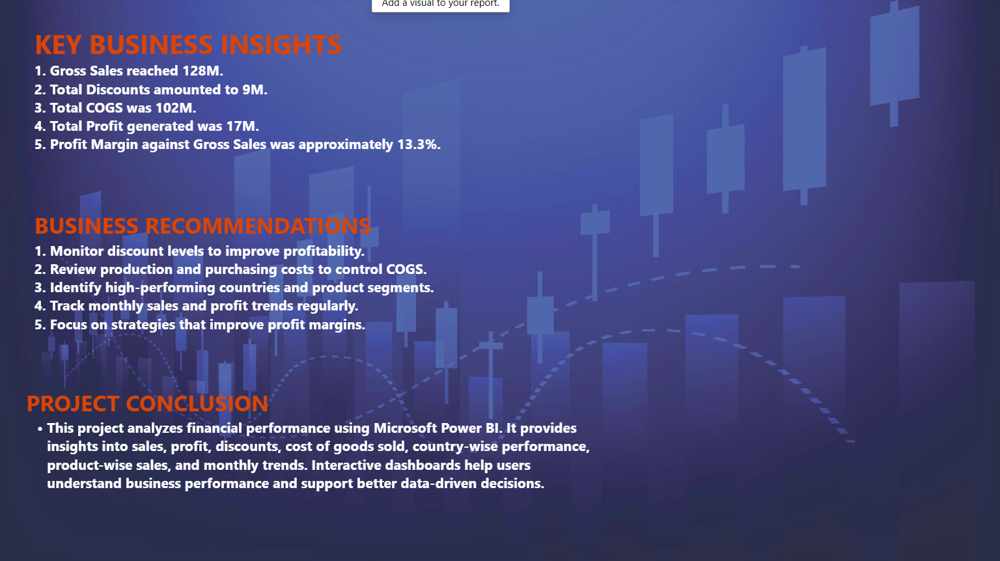

# Financial Statement Variance Analysis Using Power BI

## Project Overview
This project analyzes financial performance using Microsoft Power BI. It helps understand sales, profit, discounts, and cost performance through interactive dashboards.

## Objectives
- Analyze overall financial performance.
- Compare sales and profit across countries.
- Understand product-wise sales and discounts.
- Track monthly sales and profit trends.
- Identify important business insights.

## Tools & Technologies
- Microsoft Power BI
- Power Query
- DAX
- Microsoft Excel

## Dashboard Features
- Financial Overview
- KPI Cards
- Country-wise Sales Analysis
- Product-wise Sales Analysis
- Monthly Sales Trend
- Monthly Profit Trend
- Product-wise Discount Analysis
- Country and Year Filters
- Business Insights

## Key Performance Indicators

| Metric | Value |
|---|---:|
| Total Gross Sales | 128M |
| Total Discounts | 9M |
| Total COGS | 102M |
| Total Profit | 17M |

## Key Business Insights
- Gross Sales reached 128M.
- Discounts amounted to 9M.
- Total COGS was 102M.
- Total Profit generated was 17M.
- Profit as a percentage of Gross Sales was approximately 13.3%.

## Conclusion
This project demonstrates how Power BI can transform financial data into interactive dashboards and meaningful business insights to support data-driven decisions.

## Dashboard Screenshots

### 1. Financial Overview

### 2. Sales Trends

### 3. Business Insights

